# Shopping Pulse: Planejamento Técnico Inicial

> **Hackarun Palmas · Primeira entrega (sexta-feira, 13/11, até 12h)**
> *Transformando preferências em experiências.*

| | |
|---|---|
| **Desafio** | Gestão de eventos e experiências em shopping centers |
| **Solução** | Plataforma de engajamento e análise de experiências |
| **Tecnologia sorteada** | Miro |
| **Repositório** | https://github.com/davicode20/shopping-pulse |
| **Equipe** | *(preencher com os nomes dos integrantes)* |

---

## Sumário
1. [Problema e proposta](#1-problema-e-proposta)
2. [Proposta e estrutura inicial das telas](#2-proposta-e-estrutura-inicial-das-telas)
3. [Documentação inicial do projeto](#3-documentação-inicial-do-projeto)
4. [Linguagem de programação escolhida](#4-linguagem-de-programação-escolhida)
5. [Arquitetura proposta](#5-arquitetura-proposta)
6. [Plataforma e tecnologias adotadas](#6-plataforma-e-tecnologias-adotadas)
7. [Como o Miro será incorporado à solução](#7-como-o-miro-será-incorporado-à-solução)
8. [Escopo e prioridades](#8-escopo-e-prioridades)

---

## 1. Problema e proposta

**Problema.** A administração de um shopping decide a programação de eventos com pouca informação sobre o que os visitantes realmente desejam. Isso dificulta três momentos:

| Dimensão | Dificuldade atual | Como o Shopping Pulse responde |
|---|---|---|
| **Planejamento** | Não se sabe o que o público quer antes de investir | Publicar ideias e medir a demanda (visualizações, interesse, presença provável, faixa etária) |
| **Participação** | Divulgação sem interação, pouco engajamento | Cartões interativos estilo *swipe*, recomendações e votação em propostas |
| **Avaliação** | Resultados não são medidos de forma estruturada | Check-in por QR Code (quem realmente foi) e avaliação rápida pós-evento |

**Proposta.** Uma plataforma web com duas áreas conectadas:
- **Visitante** (celular, sem instalar aplicativo): descobre eventos, demonstra interesse, vota em ideias, faz check-in e avalia.
- **Administração** (painel de inteligência): acompanha os indicadores em tempo real e recebe recomendações geradas por inteligência artificial.

O objetivo é criar um ciclo contínuo:

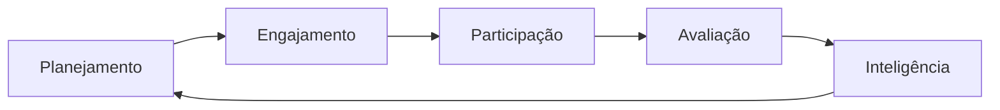

**Diferencial: validar a demanda antes de investir.** O shopping publica uma ideia (ex.: festival gastronômico de R$ 15 mil) e, antes de contratar fornecedores, sabe quantas pessoas viram, quantas se interessaram, quantas pretendem ir, qual o perfil etário e qual o custo por presença provável.

---

## 2. Proposta e estrutura inicial das telas

### 2.1. Mapa de navegação

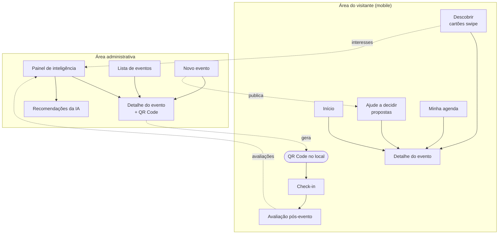

### 2.2. Telas do visitante

| Tela | Objetivo | Principais elementos |
|---|---|---|
| **Início** | Mostrar o que está acontecendo | Chamada para "Descobrir", recomendações ("Para você" / "Em alta"), filtro por categoria, lista de próximos eventos com botão de interesse |
| **Descobrir** | Coletar preferências de forma divertida | Cartões interativos: deslizar para a direita = interesse, para a esquerda = sem interesse |
| **Ajude a decidir** | Validar a demanda de ideias | Propostas em votação com "Tenho interesse" e "Eu iria!" e contador de interessados |
| **Detalhe do evento** | Informar e converter | Imagem, descrição, categoria, data, horário, local, informações, "Tenho interesse" e "Pretendo ir" |
| **Check-in** | Confirmar a presença real | Aberta pelo QR Code do local, com confirmação animada e chamada para avaliar |
| **Avaliação** | Medir a satisfação | Nota de 1 a 5, "Participaria novamente?", pontos de melhoria e comentário |
| **Minha agenda** | Fidelizar | Interesses, experiências vividas (com avaliação pendente) e recomendações |

| Início | Descobrir | Ajude a decidir | Detalhe |
|:---:|:---:|:---:|:---:|
| 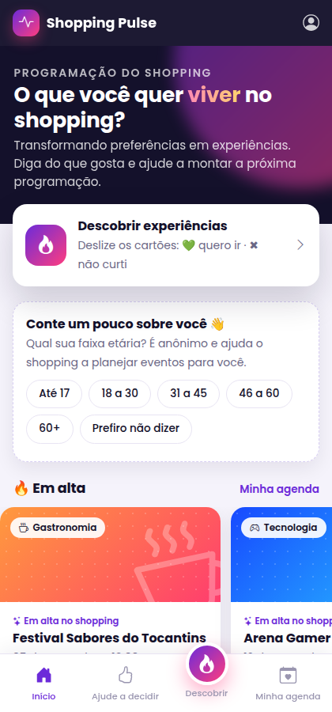 | 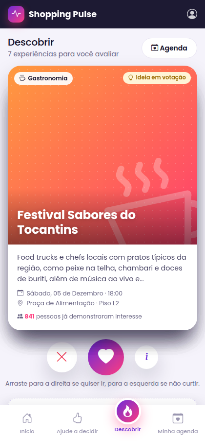 | 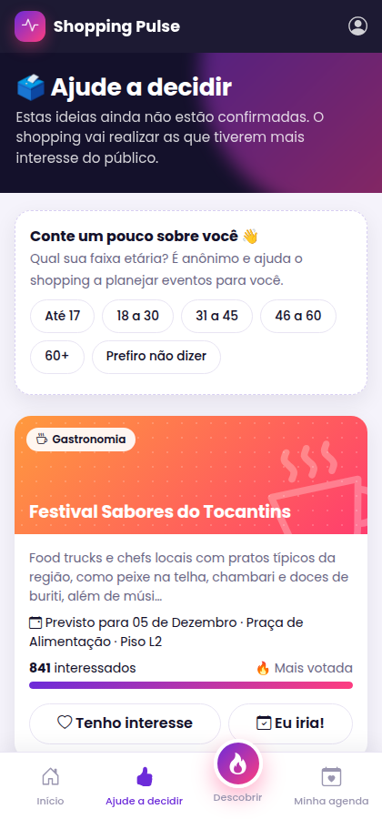 | 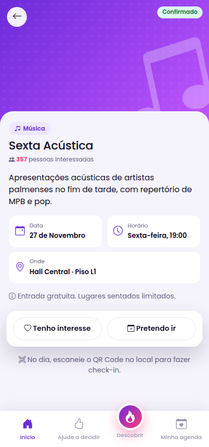 |

### 2.3. Telas da administração

| Tela | Objetivo | Principais elementos |
|---|---|---|
| **Painel de inteligência** | Visão geral em tempo real | Cards de indicadores (eventos, visitantes engajados, interesses, check-ins, comparecimento, satisfação), gráfico de linhas (evolução do engajamento), rosca (interesse por categoria), barras (eventos mais desejados), atividade ao vivo, validação de demanda e tabela de desempenho |
| **Recomendações da IA** | Transformar dados em decisão | Resumo, destaques, recomendações por prioridade, sugestões de eventos, alertas e o painel de transparência com os dados enviados |
| **Eventos** | Gerenciar a programação | Lista com status (em validação, confirmado, realizado) e métricas por evento |
| **Novo evento** | Publicar ideias e eventos | Formulário com pré-visualização de como o evento aparece no celular |
| **Detalhe do evento** | Analisar um evento | Funil (visualizaram → interessados → pretendem ir → check-in → avaliaram), faixa etária, notas, pontos de melhoria, comentários e QR Code de check-in |

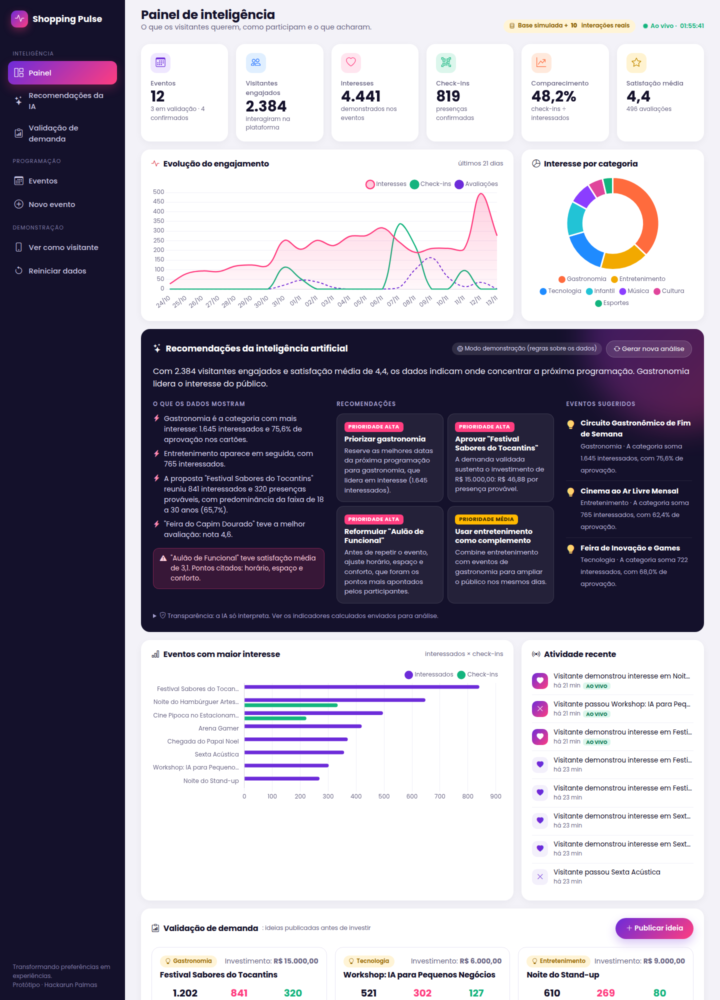

| Detalhe do evento | Novo evento |
|:---:|:---:|
| 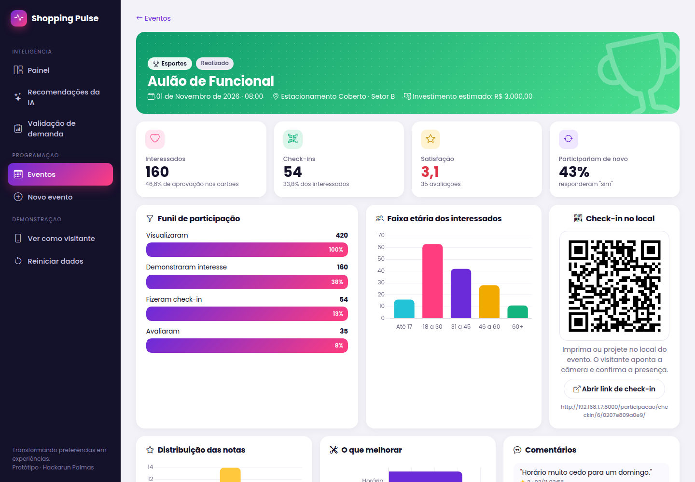 | 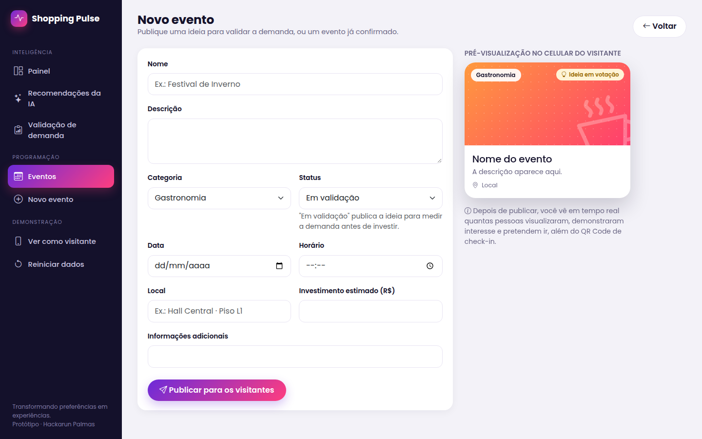 |

### 2.4. Identidade visual
- **Conceito:** modernidade, tecnologia e entretenimento. Visitante com cara de *app*, administração com cara de ferramenta profissional.
- **Cores:** roxo `#6C2BD9`, rosa `#FF3D7F` (gradiente da marca), amarelo `#FFB800` (destaque), azul-noite `#14112B` (base).
- **Tipografia:** Poppins. **Ícones:** Bootstrap Icons.
- **Categorias** com cor e ícone próprios, os mesmos nas capas e nos gráficos.

---

## 3. Documentação inicial do projeto

- **README** com instalação, execução, funcionalidades, roteiro da apresentação e decisões: [`README.md`](../README.md)
- **Este planejamento:** `docs/PLANEJAMENTO.md`
- **Quadro no Miro:** planejamento visual da equipe (ver seção 7) · *(inserir link do quadro)*

### 3.1. Como executar

```bash
git clone https://github.com/davicode20/shopping-pulse.git
cd shopping-pulse
python3 -m venv .venv && source .venv/bin/activate
pip install -r requirements.txt
cp .env.example .env
python manage.py runserver 0.0.0.0:8000
```
Visitante: `http://localhost:8000/` · Administração: `http://localhost:8000/painel/`

### 3.2. Estrutura de pastas

```
config/            configurações, rotas e nome do projeto
apps/
  eventos/         área do visitante, dados em memória e simulação
  participacao/    interesse, presença, check-in (QR Code) e avaliação
  dashboard/       painel, cálculo de indicadores, cadastro de eventos, QR Code
  inteligencia/    integração com o Google Gemini e análise de contingência
data/              eventos.json (eventos de exemplo)
templates/         visitante/ e administrativo/
static/            css/, js/, vendor/ (bibliotecas locais)
docs/              planejamento e imagens
```

### 3.3. Requisitos

**Funcionais**
| ID | Requisito | Prioridade |
|---|---|---|
| RF01 | Visitante visualiza eventos com nome, imagem, descrição, categoria, data, horário e local | Essencial |
| RF02 | Visitante demonstra interesse (swipe ou botão) | Essencial |
| RF03 | Visitante faz check-in pelo QR Code do evento | Essencial |
| RF04 | Visitante avalia a experiência após o check-in | Essencial |
| RF05 | Administração visualiza indicadores e gráficos | Essencial |
| RF06 | IA interpreta os indicadores e gera recomendações | Essencial |
| RF07 | Administração publica ideias para validar a demanda | Desejável |
| RF08 | Visitante recebe recomendações personalizadas | Desejável |
| RF09 | Exportar recomendações e resultados para um quadro do Miro | Desejável |

**Não funcionais**
| ID | Requisito |
|---|---|
| RNF01 | Interface responsiva, priorizando o celular na área do visitante, sem instalação de aplicativo |
| RNF02 | Os indicadores são calculados pela aplicação; a IA **não** gera números |
| RNF03 | A demonstração funciona sem internet (bibliotecas locais e IA com contingência) |
| RNF04 | Chaves de API apenas em variáveis de ambiente (`.env`, fora do repositório) |
| RNF05 | Visitante anônimo (identificação por sessão; faixa etária opcional) |

---

## 4. Linguagem de programação escolhida

| Camada | Linguagem | Por quê |
|---|---|---|
| **Backend** | **Python 3** | Domínio da equipe, produtividade alta, ecossistema forte para dados e IA (SDK oficial do Gemini, geração de QR Code) |
| **Frontend** | **JavaScript** (sem framework), **HTML5** e **CSS3** | Interações dos cartões, gráficos e atualização ao vivo sem a curva de aprendizado de React ou Vue |
| **Templates** | Django Template Language | Páginas renderizadas no servidor, sem precisar de uma API separada |

Com um prazo de aproximadamente um dia, a prioridade é **usar o que a equipe já domina** e evitar ferramentas que exijam configuração ou aprendizado extra.

---

## 5. Arquitetura proposta

### 5.1. Visão geral

**Monolito web em Django** (padrão MVT: *Model–View–Template*), organizado em quatro módulos com responsabilidades claras. É uma arquitetura simples, rápida de construir e fácil de evoluir.

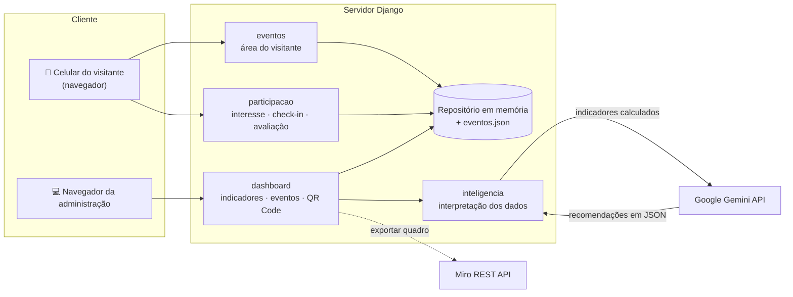

### 5.2. Módulos

| Módulo | Responsabilidade |
|---|---|
| `eventos` | Telas do visitante, recomendações, camada de dados (repositório) e geração dos dados simulados |
| `participacao` | Registro de interesse, presença provável, check-in com token e avaliação |
| `dashboard` | **Cálculo de todos os indicadores**, painel ao vivo, cadastro de eventos, QR Code |
| `inteligencia` | Envio dos indicadores ao Gemini e retorno das recomendações estruturadas; contingência por regras |

### 5.3. Fluxo de dados (do visitante à recomendação)

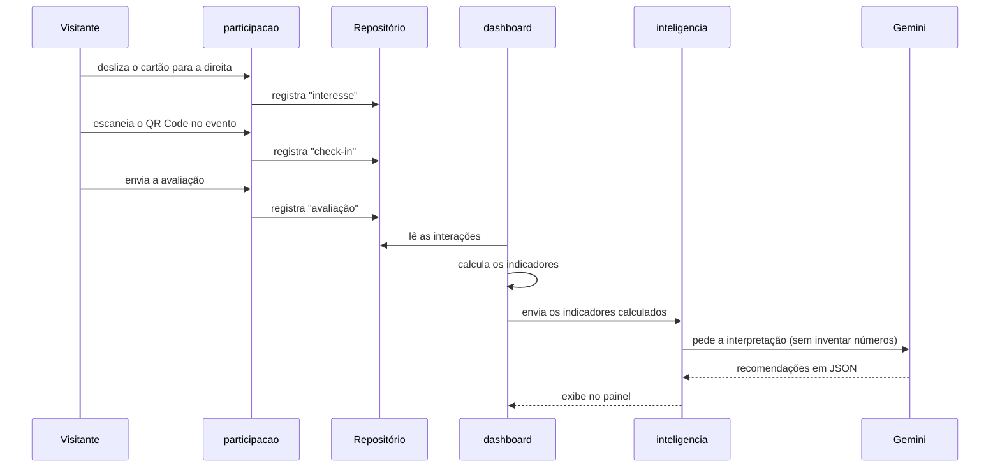

### 5.4. Modelo de dados

Para o protótipo, a decisão é **não usar banco de dados**: os eventos vêm de um arquivo JSON e as interações ficam em memória. O acesso aos dados está concentrado em um único módulo (`repositorio.py`), então trocar por um banco depois não afeta o restante do sistema.

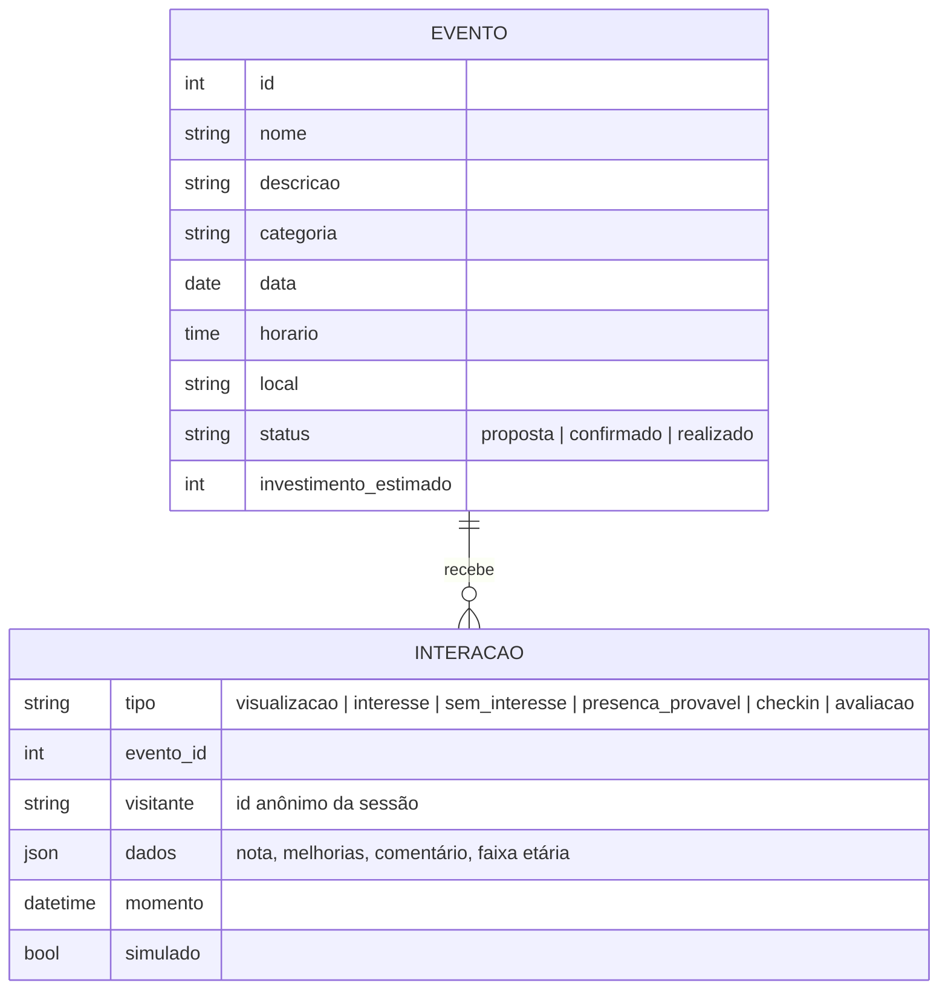

Um único registro de **interação** cobre todos os tipos de participação. Assim, cada indicador vira uma contagem simples e o modelo fica fácil de entender.

### 5.5. Decisões técnicas

| Decisão | Justificativa |
|---|---|
| Monolito Django com templates | Uma única aplicação, sem API separada nem build de frontend: menos tempo de configuração |
| Dados em memória + JSON | Foco na demonstração. Persistência isolada em um módulo para trocar por banco depois |
| **Indicadores calculados pela aplicação** | Garante números corretos e auditáveis; a IA recebe os números prontos e apenas interpreta |
| IA com contingência | Sem chave ou sem internet, recomendações por regras usando os mesmos indicadores: a apresentação não depende de serviço externo |
| QR Code com token assinado (HMAC) | Impede "adivinhar" o link de check-in de um evento |
| Visitante anônimo por sessão | Sem cadastro: menos atrito e mais participação (LGPD: nenhum dado pessoal identificável) |
| Bibliotecas servidas localmente | Demonstração estável mesmo com internet instável no evento |
| Dados simulados identificados | O painel separa a base simulada das interações reais, com transparência para os avaliadores |

---

## 6. Plataforma e tecnologias adotadas

**Plataforma:** aplicação **web responsiva**, acessada pelo navegador. O visitante usa o celular (QR Code ou link) e a administração usa o computador.

| Tecnologia | Uso na solução |
|---|---|
| **Python 3 + Django 5.2** | Backend, rotas, regras de negócio, sessões, formulários e templates |
| **HTML5 + CSS3** | Estrutura e identidade visual própria |
| **Bootstrap 5** | Grid responsivo e componentes base |
| **JavaScript** | Cartões *swipe* (Pointer Events), interações, atualização do painel a cada 5 s |
| **Chart.js** | Gráficos de linhas, rosca e barras do painel |
| **Google Gemini API** (`google-genai`) | Interpretação dos indicadores e recomendações estratégicas em JSON |
| **qrcode (Python)** | Geração do QR Code de check-in de cada evento |
| **Bootstrap Icons + Poppins** | Ícones e tipografia |
| **Miro** | Planejamento visual da equipe e quadro de planejamento da próxima programação (seção 7) |
| **Git + GitHub** | Versionamento e colaboração |
| python-dotenv | Configuração e chaves via `.env` |

**Hospedagem prevista:** execução local para a demonstração (acesso pelo celular via rede Wi-Fi). Para produção, qualquer serviço de hospedagem Python (ex.: Render, Railway ou uma VM em nuvem) com Gunicorn.

---

## 7. Como o Miro será incorporado à solução

O Miro entra em **duas frentes**: no **processo** de construção (como a equipe planeja) e no **produto** (como o shopping planeja a próxima programação).

### 7.1. No processo: quadro de planejamento da equipe

O quadro do Miro é a fonte visual de todo o planejamento. Ele é organizado em *frames*, na ordem do raciocínio:

| Frame | Conteúdo | Técnica |
|---|---|---|
| **1. Problema** | As três dimensões (planejamento, participação, avaliação) e as dores atuais da administração | Mapa de problemas |
| **2. Personas** | Visitante (jovem, família, profissional) e gestor de marketing do shopping | Cartões de persona |
| **3. Ideação** | Ideias da equipe agrupadas e votadas; escolha dos diferenciais (swipe, validação de demanda, IA) | *Brainstorming* + votação com *dot voting* |
| **4. Jornada do usuário** | Descobrir → interessar → ir → check-in → avaliar, e o lado do gestor | *User journey map* |
| **5. Telas** | *Wireframes* de baixa fidelidade de cada tela e o fluxo de navegação (base da seção 2) | *Wireframing* |
| **6. Arquitetura** | Diagrama dos módulos, fluxo de dados e integrações (base da seção 5) | Diagrama |
| **7. Backlog** | Funcionalidades classificadas em essencial, desejável e futura, com responsáveis | Kanban (A fazer · Fazendo · Feito) |
| **8. Pitch** | Roteiro da demonstração e divisão de falas | *Storyboard* |

Com isso, o quadro registra **por que** cada decisão foi tomada, e não apenas o resultado.

### 7.2. No produto: "Exportar para o Miro" (desejável)

O ciclo da solução termina em **novo planejamento**. Na vida real, a equipe de marketing do shopping planeja de forma colaborativa, em reunião, e o Miro é a ferramenta natural para isso.

**Proposta:** um botão **"Exportar para o Miro"** no painel de recomendações. Ele cria automaticamente um quadro de planejamento da próxima programação:

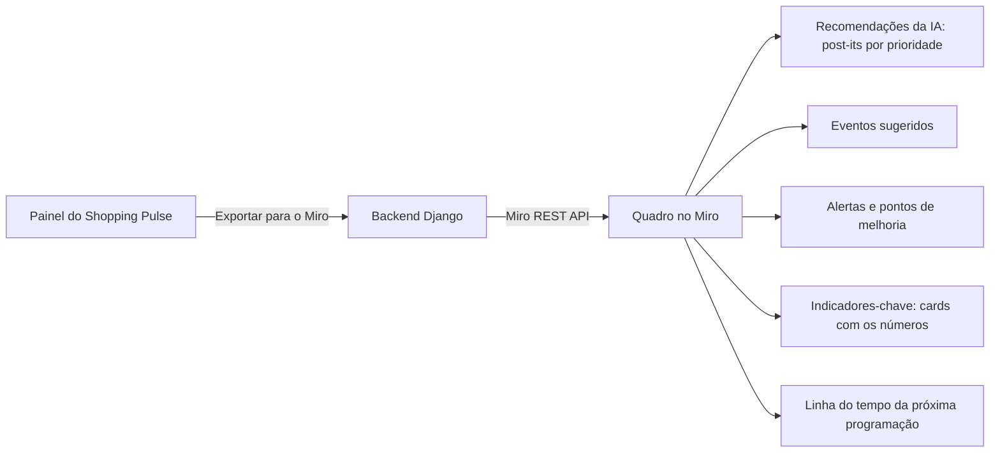

**Como funciona**
1. A administração clica em "Exportar para o Miro".
2. O backend usa a **API REST do Miro** (token guardado no `.env`, como a chave do Gemini) para criar um quadro e adicionar:
   - **post-its** coloridos com as recomendações (verde = prioridade alta, amarelo = média), os eventos sugeridos e os alertas;
   - **cards** com os indicadores calculados (interessados, comparecimento, satisfação);
   - **frames** separando "Manter", "Melhorar", "Testar" e uma linha do tempo vazia para a equipe arrastar os eventos.
3. A equipe do shopping abre o quadro e, em reunião, decide a próxima programação **com os dados dos visitantes na mesa**.
4. Os eventos escolhidos voltam para o Shopping Pulse como novas propostas, e o ciclo recomeça.

**Por que faz sentido:** o Shopping Pulse **gera a inteligência** e o Miro é **onde as pessoas decidem juntas**. A integração conecta a análise de dados ao trabalho colaborativo real da administração.

**Prioridade:** *desejável*. O fluxo principal do MVP vem primeiro. Se não houver tempo para a integração pela API, a demonstração mostra um quadro do Miro montado com as recomendações reais geradas pelo painel.

---

## 8. Escopo e prioridades

| Funcionalidade | Prioridade | Situação |
|---|---|---|
| Visualização de eventos pelo visitante | Essencial | ✅ Implementado |
| Interesse por cartões *swipe* e botão | Essencial | ✅ Implementado |
| Check-in por QR Code | Essencial | ✅ Implementado |
| Avaliação pós-evento | Essencial | ✅ Implementado |
| Painel com indicadores e gráficos (ao vivo) | Essencial | ✅ Implementado |
| Recomendações da IA (Gemini + contingência) | Essencial | ✅ Implementado |
| Validação de demanda (propostas) | Desejável | ✅ Implementado |
| Recomendações personalizadas ao visitante | Desejável | ✅ Implementado |
| Quadro de planejamento da equipe no Miro | Essencial (tecnologia sorteada) | 🔄 Em andamento |
| Exportar recomendações para o Miro (API) | Desejável | ✅ Implementado |
| Login da administração | Futura | — |
| Banco de dados (persistência) | Futura | — |
| Programa de fidelidade, cupons e *cashback* | Futura | — |
| Multi-shopping (SaaS) | Futura | — |
| Roteiros personalizados com IA e previsão de demanda | Futura | — |

**Visão de futuro:** oferecer a plataforma no modelo **SaaS**, com cada shopping tendo painel, programação, base de visitantes e histórico próprios.

---

> *Acreditamos que as melhores experiências começam quando as pessoas são ouvidas.*
